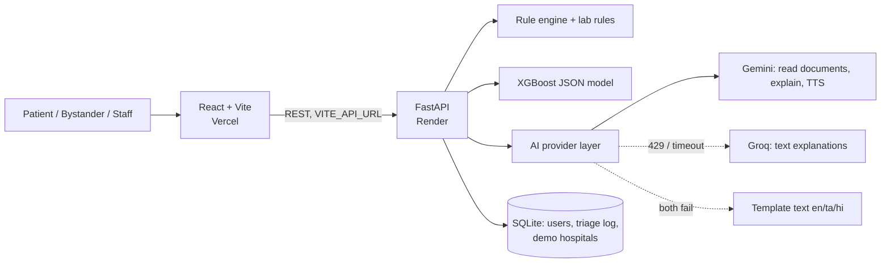

# Medyphas AI – Intelligent Patient Triage

  

Dexathon 2026 · Team **Codofobia**

> **Prototype. Demo data only. Not medical advice and not a substitute for a doctor.**
> In a real emergency in India call **108** (ambulance) or **112**.

Medyphas AI helps people understand their medical documents and know **how urgent** their situation is,
and helps a bystander get an injured person to the **right hospital** fast.

Urgency is shown as a traffic light:

| Light | Backend level | Meaning |
|---|---|---|
| 🟢 Green | `LOW` | Not urgent – follow your doctor's advice |
| 🟡 Yellow | `MEDIUM` | See a doctor soon |
| 🔴 Red | `HIGH` | Go to a hospital now / call 108 → ranked hospitals shown |

Urgency is decided **only by clinical safety rules + an ML model on the backend**. The AI (Gemini) only
*explains*; it never decides urgency, never names a diagnosis and never suggests a medicine or dose.

---

## Features

### 1. Patient mode (login)
1. Upload a **prescription or lab report** (PDF, PNG or JPG photo).
2. The backend uses **Gemini** to extract medicines (name, dose, timing, duration) and lab values
   (value, unit, reference range) as **schema-validated JSON**.
3. A simple explanation in **English, Tamil or Hindi** – only of what the doctor wrote. **Listen** button
   reads it aloud (Gemini TTS, falling back to the browser's speech).
4. **Urgency check** Green / Yellow / Red from the rule engine + lab danger rules + XGBoost.
5. If **Red**: ranked hospitals with **Google Maps directions** and one-tap **Call 108**.

### 2. Bystander mode (no login) – `/#/emergency`
- Big "Help someone in an emergency" button on the login page and in the header.
- "You can help. You don't have to give your name."
- Tap-only chips: heavy bleeding, unconscious, head injury, can't move, chest pain, breathing trouble, seizure.
- Always Red → big **Call 108** → your **GPS coordinates** in large type to read to the operator →
  best hospitals (trauma care / relevant specialty first). Works on a phone, no typing.

### 3. Medical staff
- **Triage assessment** form (vitals + symptoms) with the same Green/Yellow/Red engine and the model's top factors.
- **Hospital Beds** dashboard to update free beds (feeds hospital ranking).
- **Which Doctor?** – suggests which kind of specialist to see from symptoms (no diagnosis, no medicine;
  red-flag symptoms point to 108).
- **AI Diagnostics** chat for staff (server-side Gemini with a safety prompt), System Status page.
- Dashboard, Live Triage queue and My Health pages (the queue and charts use sample data).

---

## How urgency is decided (safety contract)

```
clinical rules (vitals, chest pain, stroke signs, seizure…)  ─┐
lab danger rules (potassium, sodium, glucose, Hb, platelets…) ─┼─► final = max(...)  ─► Green / Yellow / Red
XGBoost model (or rules-only baseline if the model fails)     ─┘
```
- Any clinical rule or critical lab value ⇒ **Red**. A lab value outside the printed range ⇒ at least Yellow.
- The ML model can only **raise** urgency – it can **never downgrade** a rule-based Red (tested).
- If the model can't load, triage keeps working on rules only.
- Hospital ranking: score = 60 × specialist match + 20 × free beds + 20 × distance (haversine).
  The required specialty comes from the same `assign_department()` used in triage.

## Architecture



| Layer | Tech |
|---|---|
| Frontend | React 19, TypeScript, Vite 6, Tailwind (CDN), React Router (hash routes) |
| Backend | Python 3.11, FastAPI, SQLAlchemy (async) + SQLite, bcrypt + JWT |
| ML | XGBoost (`xgboost-cpu`) trained on **synthetic** data (`ml/generate_data.py`); native JSON model; per-patient factors from XGBoost tree contributions |
| AI | `google-genai` SDK (model from `GEMINI_MODEL`), Groq fallback (`GROQ_MODEL`), in-memory cache by file hash |

The model's ~97% accuracy is measured on the **synthetic** test set it was generated with; it says
nothing about real-world clinical performance.

## Repository layout

```
medyphas-ai---intelligence-hub/   React frontend (deployed to Vercel)
triageai-backend/                 FastAPI backend (deployed to Render)
  app/                            API, services (rules, lab rules, ML, AI provider, hospitals)
  app/data/hospitals.json         DEMO hospitals (fictional names, beds, phone numbers)
  ml/                             data generator, training script, committed model files
  tests/                          pytest suite
demo/                             fictional sample prescription / lab reports for demos
render.yaml                       Render Blueprint for the backend
Externalmodel-colab/              old Colab models – NOT used, excluded from git and deploy
```

---

## Run locally

See [run.txt](run.txt) for step-by-step commands. Short version:

```bash
# Backend (Python 3.11)
cd triageai-backend
python -m venv .venv && source .venv/bin/activate      # Windows: .venv\Scripts\activate
pip install -r requirements.txt
cp .env.example .env                                   # add GEMINI_API_KEY (optional)
uvicorn app.main:app --reload --port 8000

# Frontend
cd medyphas-ai---intelligence-hub
npm install
cp .env.example .env                                   # VITE_API_URL=http://localhost:8000
npm run dev                                            # http://localhost:3000
```

Demo accounts (created on startup): `dr_strange` / `password123` (staff), `patient_demo` / `password123` (patient).
These are public demo credentials – change `DEMO_USER_PASSWORD` or set `SEED_DEMO_USERS=false` for anything else.

Tests: `cd triageai-backend && pytest` (rules, lab rules, "ML never downgrades Red", hospital ranking,
specialist helper never returns medicines, AI fallback chain with mocked providers, auth).

## Environment variables

**Backend** (`triageai-backend/.env` locally, Render dashboard in production) – keys live **only** here:

| Variable | Purpose | Default |
|---|---|---|
| `GEMINI_API_KEY` | Gemini (documents, explanations, TTS, staff chat) | empty → template text, uploads disabled |
| `GEMINI_MODEL` | Gemini text/vision model | `gemini-3.8-flash` |
| `GEMINI_TTS_MODEL` | Read-aloud model | `gemini-3.8-flash-tts` |
| `GROQ_API_KEY` | Fallback for text explanations | empty → skipped |
| `GROQ_MODEL` | Groq model | `openai/gpt-oss-120b` |
| `CORS_ORIGINS` | Comma-separated frontend URLs | `http://localhost:3000,http://localhost:5173` |
| `CORS_ORIGIN_REGEX` | Optional, e.g. Vercel preview URLs | empty |
| `DATABASE_URL` | SQLAlchemy URL | SQLite in `triageai-backend/data/` |
| `SECRET_KEY` | JWT signing secret | dev-only value – **set in production** |
| `SEED_DEMO_USERS`, `DEMO_USER_PASSWORD` | Demo accounts | `true`, `password123` |

**Frontend** (`medyphas-ai---intelligence-hub/.env`, Vercel project settings): only `VITE_API_URL`.
Never put API keys in the frontend – everything prefixed `VITE_` is public.

---

## Deploy (free tiers)

### Backend → Render
1. Push this repo to GitHub.
2. Render → **New → Blueprint** → select the repo. It reads [render.yaml](render.yaml)
   (free web service, `rootDir: triageai-backend`, Python 3.11 from `.python-version`,
   `pip install -r requirements.txt`, `uvicorn app.main:app --host 0.0.0.0 --port $PORT`, health check `/api/health`).
3. Enter the prompted secrets: `GEMINI_API_KEY` and `GROQ_API_KEY` (optional). `SECRET_KEY` is generated.
4. Wait for the deploy, then open `https://<your-service>.onrender.com/api/health` →
   `"model_loaded": true`.

### Frontend → Vercel
1. Vercel → **Add New → Project** → import the repo.
2. **Root Directory:** `medyphas-ai---intelligence-hub` (framework Vite is detected; `vercel.json` sets build/output).
3. `VITE_API_URL` is already set to the Render URL in `medyphas-ai---intelligence-hub/.env.production`
   (change it there if your Render URL differs, or override it in Vercel's Environment Variables). Deploy.
4. `CORS_ORIGINS` is set to `https://medyphas.vercel.app` in `render.yaml`. If your Vercel URL differs, change it
   there (or in Render → Environment) and redeploy with **Save, rebuild, and deploy**.

### Free-tier notes
- Render free services **sleep after ~15 min idle**; the first request can take up to a minute. The app shows
  "Waking up server…" after 3 s. Open the site a minute before a demo.
- Render's free disk is **temporary**: SQLite is wiped on every restart/deploy. Demo users and hospitals are
  re-seeded on startup; triage history and bed edits are not kept.
- **Free-tier AI may use submitted data** (Gemini / Groq terms). Demo with the fictional files in
  [demo/](demo/) only – never upload real patient documents.

---

## Limitations

- Prototype for a hackathon; not clinically validated, not a medical device.
- The XGBoost model is trained on synthetic data; rules thresholds are textbook adult values.
- Hospital data is fictional; distance is straight-line, not travel time.
- Tamil/Hindi template text should be reviewed by native speakers; AI translations can contain errors.

## Team

Team Codofobia – Dexathon 2026. Original full-stack and AI work by Ajay Kumar Reddy.

**Medical disclaimer:** Medyphas AI is for education and demonstration only. It does not replace licensed
medical professionals. Always consult a qualified healthcare provider. In an emergency call 108.
